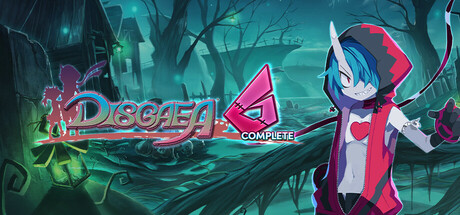

**Disgaea 6: Defiance of Destiny introduces the Zombie protagonist Zed challenging the God of Destruction for his deceased sister. Features a new Super Reincarnation mechanic and auto-battle system to handle grinding automation.**

---

## 📖 About

Disgaea 6: Defiance of Destiny introduces the Zombie protagonist Zed challenging the God of Destruction for his deceased sister. Features a new Super Reincarnation mechanic and auto-battle system to handle grinding automation.

## ⚠️ Problems Without Trainer

| Problem | Status |
|---------|--------|
| **Super Reincarnation Depth** — Optimizing reincarnation for stat inheritance requires system understanding | ✅ Solved |
| **Auto-Battle Setup** — Configuring effective auto-battle routines requires menu navigation practice | ✅ Solved |
| **Later Chapter Difficulty** — Post-game content is dramatically harder than story chapters | ✅ Solved |
| **Juice Bar Management** — Understanding the Juice Bar stat boost system optimally requires knowledge | ✅ Solved |

## ✅ Solution

The **Disgaea 6 Trainer** solves all these issues by giving you complete control over the game.

## 🎯 Full Feature List

- Unlimited Resources
- God Mode / Invincibility
- Instant Skill Cooldown
- One-Hit Kill
- Freeze Game Timer
- Unlock All Items & Achievements
- Custom Speed Multiplier
- Save State Anywhere

## 🚀 Quick Start

1. **Disable Windows Defender** temporarily (trainer may trigger false positive)
2. Download the trainer from the button above
3. Launch Disgaea 6
4. Run the trainer as Administrator
5. Activate desired cheats with hotkeys

## 💎 Free vs Paid

| Feature | Free | Pro |
|---------|------|-----|
| Basic God Mode | ✅ | ✅ |
| Unlimited Resources | ✅ | ✅ |
| All Advanced Cheats | ❌ | ✅ |
| Auto-Updates | ❌ | ✅ |
| Priority Support | ❌ | ✅ |

## 💻 Requirements

- Windows 10/11 (64-bit)
- Disgaea 6 (any version)
- .NET Framework 4.8+
- DirectX 11+

## 🍎 macOS

macOS users can use our alternative tool:

## ⚖️ Legal

This trainer is for educational and single-player use only. Use responsibly.

---

